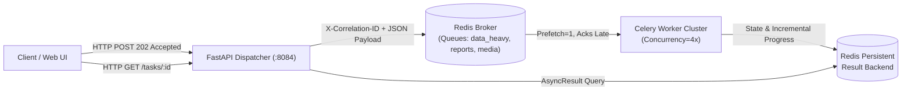

# Rivult: Scalable Background Task Orchestration Engine

Rivult is a production-grade, asynchronous background task orchestration microservice built with **Python 3.13**, **FastAPI**, and **Celery**, backed by **Redis** as both a high-throughput message broker and a persistent result backend.

---

## ⚡ Core Architecture



---

## Key Features

1. **Instant Task Dispatching**:
   - `POST /api/v1/tasks/aggregation` – Dispatches multi-dimensional data cube aggregation with statistical anomaly detection.
   - `POST /api/v1/tasks/report` – Dispatches batch analytical report compilation (PDF/CSV/XLSX).
   - `POST /api/v1/tasks/image-pipeline` – Dispatches multi-stage media transformation batches.
   - Returns immediate HTTP `202 Accepted` with a UUID task identifier and polling URL.

2. **Celery Worker Engine & Resilience**:
   - **Concurrency Limit**: Bounded to 4 concurrent worker processes with `worker_prefetch_multiplier = 1` to prevent worker starvation.
   - **Late Acknowledgements (`acks_late=True`)**: Tasks are only acknowledged upon successful execution, preventing job loss on worker crash.
   - **Automatic Retries**: Backed by exponential backoff (`autoretry_for=(TransientUpstreamError,)`, `retry_backoff=True`, `max_retries=3`).
   - **Persistent Result Tracking**: Progress transitions (`PENDING` ➔ `PROGRESS` ➔ `SUCCESS`/`FAILURE`) with 24-hour persistence in Redis.

3. **Strict Pydantic v2 Validation**:
   - `extra="forbid"` and auto-stripping whitespace.
   - Field validators for ISO dates, alphanumeric dataset keys, and valid email recipient lists.

4. **Structured JSON Logging**:
   - Standardized output with `timestamp`, `level`, `logger`, `message`, `correlation_id`, `task_id`, `duration_ms`, and exception traces.

5. **Pytest Coverage**:
   - 19 automated tests covering request schemas, API endpoints, worker tasks, and simulated transient retry exceptions.

6. **Interactive Documentation & Telemetry UI**:
   - Live dashboard at `http://localhost:8084/` featuring task dispatch tabs, real-time progress bar polling, and JSON result inspection.

---

## Quickstart

### Option A: Local Development

```bash
# 1. Activate virtual environment
.\.venv\Scripts\activate

# 2. Start the FastAPI API server
uvicorn app.main:app --host 0.0.0.0 --port 8084 --reload

# 3. Start a Celery worker (in separate terminal)
celery -A app.celery_app.celery_app worker --loglevel=INFO --concurrency=4 -Q default,data_heavy,reports,media
```

### Option B: Docker Compose

```bash
docker-compose up --build
```
Services exposed:
- **FastAPI API & UI**: `http://localhost:8084`
- **Swagger Docs**: `http://localhost:8084/docs`
- **Flower Monitoring Dashboard**: `http://localhost:5555`
- **Redis**: `localhost:6379`

---

## Running the Test Suite

```bash
pytest tests/ -v
```
All 19 tests run with in-memory isolation without external server dependencies.
